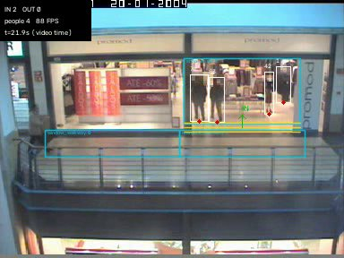

# RetailFlow: Intelligent Visual Analytics for Retail Spaces

People counting, zones, dwell time and heatmaps from **angled and side-view CCTV**
(not overhead), evaluated against public ground truth, with a live dashboard.



Every number in this README comes from a run on the development laptop (RTX 4060 Laptop, 8 GB)
and can be reproduced with the commands in [`docs/12_DEMO.md`](docs/12_DEMO.md).

---

## What the client asked for, and what was delivered

| Requirement | Delivered | Evidence |
|---|---|---|
| **1. Angled / side-view CCTV** | Counting on the **feet point** (bottom of the box), on the floor where the line is drawn, not the box centre that floats above it. Only static angled cameras used (camera motion measured). | Shop entrance: classic box-centre method **133% error**, feet point + band **19.4%** ([doc 04](docs/04_COUNTING_RELIABILITY.md)) |
| **2. Reliable in/out counts, also when busy** | Band (hysteresis) line logic, detector/tracker chosen on dev data only, a `crowd` profile for dense cameras. | See the table below; busiest test set MOT20: **85.7% → 30.2%** error ([doc 10](docs/10_RESULTS.md)) |
| **3. Zones, dwell, heatmaps** (if possible) | Debounced zone visits with dwell time, occupancy over time, person-seconds heatmaps, mannequin filter, zone-to-zone transition matrix. | Corridor: time-in-zone error **15.5%**, heatmap correlation **0.93** with ground truth (measured on the Phase 3 tracks); zone-to-zone moves **9.3%** error ([doc 05](docs/05_ZONES_DWELL_HEATMAP.md)) |
| Staff filtering | Rule: time spent in staff zones; flags are retroactive. | Works when tracking keeps one ID; found the assistant in 1 of 2 test clips ([doc 06](docs/06_STAFF_AND_PRIVACY.md)) |
| Privacy | Anonymous events only, `--blur-heads`, ReID only in memory, people-free heatmap backgrounds. | [doc 06](docs/06_STAFF_AND_PRIVACY.md) |
| Backend + dashboard | FastAPI + PostgreSQL + Next.js, Docker Compose, live sessions. | [doc 07](docs/07_BACKEND_DASHBOARD.md) |
| RTSP, multiple streams, ONNX/TensorRT | FFmpeg + MediaMTX simulated cameras, `run_multi.py`, TensorRT FP16. | **4** small / **2** full-HD / **1** crowd camera in real time on the laptop ([doc 08](docs/08_STREAMING_PERFORMANCE.md)) |
| Multi-camera | Both CAVIAR views synced from the burned-in clock; two-camera door fusion; one ID per person across 15 calibrated cameras (synthetic store). | 72,518/72,518 frames synced; fusion did **not** beat one good camera; cross-camera IDF1 0.110 → 0.281 (floor linking) → 0.369 (+ colour) → **0.436** (+ ghost/short-track filter) ([doc 11](docs/11_MULTI_CAMERA.md)) |

## Headline result: counting before and after

IN/OUT error as **WAPE** (Σ|errors| / Σ true crossings; an extra IN cannot cancel a missed OUT).
**Dev** cameras were used for every choice; **test** cameras were never used to choose anything
(two documented exceptions: the crowd profile and the mannequin filter).

| Camera group | Split | True crossings | Classic (box centre) | Baseline (feet + band, YOLO26n) | **Final** |
|---|---|---|---|---|---|
| CAVIAR corridor (26 clips) | dev | 95 | 83.2% | 34.7% | **23.2%** |
| MOT17 street scenes (3) | dev | 43 | 44.2% | 23.3% | **18.6%** |
| CAVIAR shop entrance (26 clips) | test | 72 | 133.3% | 20.8% | **19.4%** |
| MOT20 crowds, 46–195 people per frame (4) | test | 1,066 | 81.5% | 85.7% | **30.2%** |

**Final system:** YOLO26m (TensorRT FP16, 960 px; 1920 px `crowd` profile on dense cameras),
BoT-SORT without camera-motion compensation, feet point + band. **12.3 ms per frame** on dev
(Phase 3 PyTorch version: 28.8 ms) with the same accuracy.

What is **not** solved, in plain words:
- **Packed crowds:** MOT20-05 (195 people per frame) still misses about a third of its crossings.
  The detector does not see enough people; a crowd-trained detector would be the next step.
- **MOT20-02 over-counts** with the crowd profile (45 errors on 114 crossings) while the other crowds
  under-count. Reported, not tuned away on test data.
- **One hour live on real footage** (MEVA, full HD, 30 fps): runs the whole hour live into the dashboard
  (lag at most 3.1 s), but skips 2.5% of the frames over the hour: no headroom left on this laptop
  ([doc 08 §9](docs/08_STREAMING_PERFORMANCE.md)).
- **Cross-camera identities** (synthetic store, 15 cameras): floor linking + colour matching lift global IDF1 from
  0.110 to 0.369, but people are still split into many IDs (169 seen ≥ 10 s for 31 true); a steadier per-camera
  tracker and a learned re-identification model are the next steps.
- **Store zones** are scored against ground truth (test minutes, offline): people per zone 0.59 error per second,
  time in zones 12.4% off, moves 20.2%, visits 29.6% (57.7% live). People seen for under 5 s are not counted.
- **People in view / total people** per camera: in view is close (0.64 people error on test); the total is an
  estimate that over-counts when tracking breaks (test 61.7% off, from 312% when every track ID counts).
- **Staff filtering** depends on the tracker keeping one ID. No public dataset labels staff, so it is not scored.

## Quick start (Windows, PowerShell)

```powershell
# 1. Python environment (3.12) with CUDA PyTorch
py -3.12 -m venv .venv; .\.venv\Scripts\Activate.ps1
pip install torch torchvision --index-url https://download.pytorch.org/whl/cu130
pip install -r requirements.txt
python tools/check_gpu.py

# 2. Data (public research datasets; sizes and licences in tools/download_data.md)
python tools/download_caviar.py                       # 581 MB

# 3. One video -> annotated output
python run.py --source data/caviar/TwoEnterShop1front/TwoEnterShop1front.mpg `
              --scene scenes/caviar_front.json --save-video --blur-heads

# 4. Live camera -> dashboard (Docker Desktop running)
.\demo.ps1                                            # then http://localhost:3001
.\demo.ps1 -Preview                                   # + annotated live video at http://127.0.0.1:8090
python run_store.py --store scenes/stores/smartspaces_071.json --api http://127.0.0.1:8000 --preview   # 15-camera store live

# Optional: TensorRT FP16 engines (about 2x faster; built for this GPU)
pip install -r requirements-export.txt
python tools/export_models.py
```

`run.py` uses the TensorRT engine automatically once it has been built (`--backend auto`),
and PyTorch otherwise. Tests: `pytest -q` (128 tests; the API integration test runs when the stack is up).

## How it works

```
 video file / image folder / RTSP ──► detector + tracker ──► feet point ──► line counter (band)  ──► events
   (sources.py)                       YOLO26 + BoT-SORT                 ├─► zones: visits, dwell     (anonymous)
                                       (detector.py, profiles.py)        ├─► heatmap (person-seconds)     │
                                                                         ├─► staff rule, mannequin filter │
                                                                         └─► head blur on output video    │
                                                                                                          ▼
                                     PostgreSQL ◄── FastAPI (:8000) ◄── HTTP sender ◄─────────────── events.csv
                                                      │
                                                      └──► Next.js dashboard (:3001)
```

One **scene file** per camera (`scenes/<camera>.json`) holds everything that depends on where the
camera hangs: counting line, IN side, band width, zones, staff rule, mannequin filter, detector
profile. Draw it with `python tools/setup_scene.py`. Details: [doc 02](docs/02_ARCHITECTURE.md).

## Documentation

| Doc | Content |
|---|---|
| [00 Progress log](docs/00_PROGRESS_LOG.md) | Every phase: what was done, commands, results, lessons |
| [01 Setup and data](docs/01_SETUP_AND_DATA.md) | Environment, datasets, camera-motion check |
| [02 Architecture](docs/02_ARCHITECTURE.md) | Modules, event schema, design decisions |
| [03 Detection and tracking](docs/03_DETECTION_AND_TRACKING.md) | YOLO26, ByteTrack vs BoT-SORT, ReID, GMC |
| [04 Counting reliability](docs/04_COUNTING_RELIABILITY.md) | Feet point, band, filters, grid, crowd profile |
| [05 Zones, dwell, heatmaps](docs/05_ZONES_DWELL_HEATMAP.md) | Visits, debouncing, heatmaps, mannequin filter |
| [06 Staff and privacy](docs/06_STAFF_AND_PRIVACY.md) | Staff rule and what it really does; head blur |
| [07 Backend and dashboard](docs/07_BACKEND_DASHBOARD.md) | Data model, API, dashboard, sender |
| [08 Streaming and performance](docs/08_STREAMING_PERFORMANCE.md) | TensorRT, GMC bottleneck, RTSP, multi-stream capacity |
| [09 Evaluation method](docs/09_EVALUATION_METHOD.md) | Ground truth, dev/test split, metrics |
| [10 Results](docs/10_RESULTS.md) | All result tables |
| [11 Multi-camera](docs/11_MULTI_CAMERA.md) | Clock sync of two views, two-camera fusion, cross-camera IDs |
| [12 Demo](docs/12_DEMO.md) | Three ways to see it working |
| [Troubleshooting](docs/TROUBLESHOOTING.md) | Every problem met, its cause and fix |

## Repository layout

```
retailflow/        the library: sources, detector, counting, zones, heatmap, staff, privacy, pipeline, sender, ...
run.py             one camera (file, folder or RTSP)          run_multi.py   N live streams at once
benchmark.py       detector/tracker runs over all datasets     evaluate*.py   scoring against ground truth
scenes/            one JSON per camera (+ sites/ for multi-camera)
trackers/          tracker configs (BoT-SORT + ReID, BoT-SORT without GMC)
backend/           FastAPI + SQL schema                         dashboard/     Next.js
tools/             downloads, scene editor, exports, RTSP simulator, clock sync, checks
tests/             124 tests                                     docs/          everything above
```

## Data acknowledgements and licences

- **CAVIAR**: EC Funded CAVIAR project/IST 2001 37540 (<https://homepages.inf.ed.ac.uk/rbf/CAVIAR/>), CC BY-SA.
- **MOT17 / MOT20**: MOTChallenge (<https://motchallenge.net>), CC BY-NC-SA 3.0. Non-commercial research use.
- **MEVA**: Kitware Inc. and IARPA (<https://mevadata.org>), CC BY 4.0. Corona et al., WACV 2021. Used for the one-hour live test.
- **NVIDIA PhysicalAI-SmartSpaces** (<https://huggingface.co/datasets/nvidia/PhysicalAI-SmartSpaces>), CC BY 4.0. One synthetic retail scene for multi-camera work.
- Datasets are downloaded by the scripts, never redistributed in this repository. Images in `docs/img`
  are annotated frames from these datasets, with heads pixelated.
- Models: Ultralytics YOLO26 (AGPL-3.0). Note this licence before any commercial deployment.
