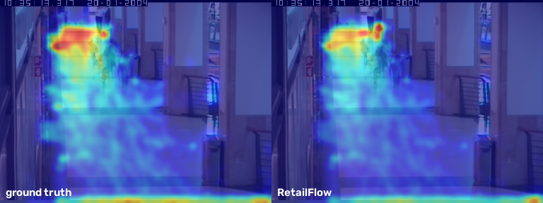
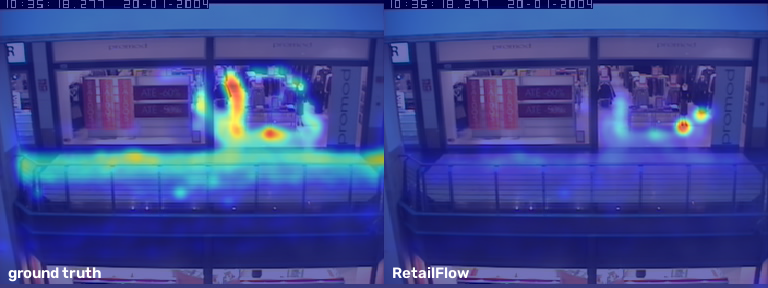

# 05 · Zones, dwell time and heatmaps

Client requirement 3 ("if possible"): zone, dwell-time and heatmap views.

| Module | What it does |
|---|---|
| `retailflow/zones.py` | Is each person in each zone? Visits, dwell time, occupancy |
| `retailflow/heatmap.py` | Person-seconds per floor cell; image or floor-plan grid |
| `retailflow/static_filter.py` | Drops tracks that never move (mannequins) |
| `retailflow/analytics_eval.py`, `evaluate_zones.py` | Scores all of this against ground truth |

---

## 1. Zones

A zone is a named polygon in the scene file, drawn on the floor:

```json
"zones": [{"name": "shop_inside", "polygon": [[205, 65], [335, 65], [335, 138], [205, 138]]}]
```

A person is in a zone when their **feet point** is inside the polygon (ray-casting
test, `points_in_polygon`). The feet point is used for the same reason as in counting: in an angled view,
only the feet are on the floor.

Zones were placed like the counting lines: from ground-truth traffic plots, before
looking at any system output.

| Camera | Zones |
|---|---|
| `caviar_cor` | `far_end` (shop doorways at the far end), `corridor_mid`, `corridor_near` |
| `caviar_front` | `shop_inside` (inside Promod, seen through the glass), `window_walkway`, `entrance_walkway` |
| `MOT17-09` | `vodafone_front`, `woolworths_front` (pavement in front of each shop) |

## 2. Visits, dwell and occupancy

`ZoneTracker` keeps a small state per (track, zone) and **debounces** like the counting band:

- a visit **starts** after `enter_s` seconds inside without a break, and is back-dated to the first of those frames;
- a visit **ends** after `exit_s` seconds outside *or not detected*, and its end is the
  last frame the person was really inside;
- `dwell_s = (end − start + 1) / fps`;
- **occupancy** of a zone = visits in progress right now.

**Worked example** (from `tests/test_zones.py`; 10 fps, enter 0.3 s = 3 frames, exit 0.4 s = 4 frames):

| Frames | Feet point | Result |
|---|---|---|
| 0–4 | inside | visit confirmed at frame 2, back-dated to frame 0 |
| 5–6 | outside (2 frames < 4) | visit continues: jitter on the edge |
| 7–11 | inside | |
| 12–16 | outside | visit ends at frame 15; end = frame 11 (last inside) |
| | | **one visit, dwell = 12 frames = 1.2 s** |

Without debouncing, the same walk would be 2 visits. Missed detections are bridged in
the same way, so a short occlusion does not split a visit.

In the pipeline this runs online and emits `zone_enter` (stamped with the visit's real,
back-dated start) and `zone_exit` (stamped with its real end; dwell in `value`). The
backend rebuilds occupancy over time from these visits (doc 07). Offline, `zone_analysis()` runs **the
same class** on saved tracks and on ground truth, so true and predicted dwell use identical rules.

## 3. Choosing the debounce times (dev only)

`python evaluate_zones.py --sweep` scores 36 combinations on the dev cameras
(`caviar_cor`, MOT17-09) with the final tracks. **Visit WAPE** = Σ|pred visits − true visits| / Σ true visits.
**Person-seconds WAPE** is the same for total time in zones.

| enter | exit | Dev visit WAPE | Dev person-s WAPE | Dev occupancy MAE |
|---|---|---|---|---|
| 0.12 s | 0.48 s | 94.1% | 23.5% | 0.341 |
| 0.4 s | 1.0 s | 57.5% | 23.6% | 0.335 |
| 1.0 s | 2.0 s | 34.3% | 22.8% | 0.322 |
| **2.0 s** | **2.0 s** | **26.9%** | **22.6%** | 0.303 |
| 2.0 s | 4.0 s | 27.6% | 22.4% | 0.316 |

(The sweep ran in frames at 25 fps; the table shows the same values in seconds.)

- **Total time in zones is stable** (22–24%) whatever the setting. **Visit counts are not**:
  with short debounce times, every ID switch or brief miss starts a new "visit", and visits
  are over-counted by up to 2–3×.
- **Chosen: 2 s / 2 s.** In business terms, a visit is "at least 2 s in the zone" (shorter is
  passing through), and stepping out for under 2 s doesn't end it. Because ground truth is
  scored with the same definition, this is a definition choice, not a trick: both sides
  ignore passes shorter than 2 s.
- The settings are stored in **seconds**, so 25 fps (CAVIAR) and 30 fps (MOT17) mean the same thing.

## 4. Heatmaps

Each frame, each person adds `1/fps` seconds at their feet point to a grid. The result
is **person-seconds per cell**. Cells are about 1/190 of the image width (2 px at
384 px, 10 px at 1920 px). The rendered `heatmap.png` uses a square-root colour scale over
a **median background** (the per-pixel median of 15 sampled frames), which removes
moving people, so no person appears in the image.

**Image grid vs floor grid.** In an angled view, a far-away pixel covers more floor
than a near one, so on an image grid far areas look colder than they are. If the scene
has a **homography** (4+ image points with floor coordinates, from `tools/setup_scene.py`),
points are mapped to the floor plan first and the grid is in metres (default 0.25 m
cells). None of the public datasets include floor measurements, so every scene here uses the
image grid. Inventing floor coordinates would make the metres meaningless. The floor
mapping is covered by a unit test (`test_homography_maps_to_floor_cells`).

## 5. Static-object filter (mannequins)

**Found during evaluation (§6, test camera):** the hottest predicted spots on the shop-front
camera were **mannequins** inside the shop. The detector sees them as people, they are not
in the ground truth, and they sat in `shop_inside` for whole clips.

**Rule** (`static_filter.py`, decided from reasoning before measuring): a finished track is
static if it lived ≥ 10 s and its feet moved less than 0.5 × its median box height in
both x and y. A real person waiting still **arrives and leaves**, so their whole track moves.

Because this was found on a test camera, it is labelled as **post-diagnosis**, like the
crowd profile in Phase 3. It was then checked on dev and on ground truth:

| Check | Result |
|---|---|
| Dev `caviar_cor`, visit WAPE | 27.4% → **20.1%** |
| Dev `caviar_cor`, person-seconds WAPE | 22.4% → **15.5%** |
| Dev `caviar_cor`, heatmap correlation | 0.797 → **0.926** |
| Rule applied to **ground truth** (real people wrongly removed) | caviar_front 0%, caviar_cor 2.7%, MOT17-09 0%, MOT20 0–0.35%, **MOT17-02 9.9%, MOT17-04 26.5%** |

On MOT17-04 (a street), many labelled people stand still for their whole visible life,
so the rule would remove real people. That is why it is a **per-camera switch**
(`"static_filter": true`), turned on for the two shopping-centre cameras, where mannequins
and shop fittings are in view, and off for the street scenes. In a real store it should be
turned off for a camera watching a till or a seating area.

In the pipeline, a track's heatmap cells are buffered until the track ends (unseen 2 s).
Then it is either flagged (`static_flag` event) and dropped, or added to the heatmap.

## 6. Results

Final settings: 2 s / 2 s debounce. Static filter on CAVIAR. Staff rule on `caviar_front` (doc 06).
`python evaluate_zones.py`. Raw rows: `outputs/zones_results.csv`, `outputs/heatmap_results.csv`.

### 6.1 Zones (per camera, all clips)

| Camera | Split | True visits | Pred visits | Visit WAPE | Person-s WAPE | Occupancy MAE | Mean dwell true / pred |
|---|---|---|---|---|---|---|---|
| `caviar_cor` | dev | 339 | 399 | 20.1% | 15.5% | 0.223 | 14.2 s / 11.9 s |
| MOT17-09 | dev | 20 | 15 | 25.0% | 35.9% | 1.106 | 6.1 s / 5.2 s |
| `caviar_front` | test | 205 | 175 | 48.8% | 49.8% | 0.169 | 5.5 s / 5.0 s |

Occupancy MAE is in people: on average the predicted number of people in a zone is off
by this much per frame. Without the static filter: `caviar_cor` 27.4% / 22.4% / 0.296;
`caviar_front` 57.4% / 56.2% / 0.251.

Per zone (same settings):

| Zone | Visit WAPE | Person-s WAPE | Note |
|---|---|---|---|
| `caviar_cor/corridor_near` | 1.7% | 4.4% | near the camera, people large |
| `caviar_cor/corridor_mid` | 10.5% | 5.3% | |
| `caviar_cor/far_end` | 56.4% | 32.5% | far away, people ≤ 30 px; extra fragmented visits |
| `caviar_front/window_walkway` | 39.7% | 36.4% | **under**-predicted: walkway people partly behind the glass railing |
| `caviar_front/entrance_walkway` | 39.5% | 39.1% | same |
| `caviar_front/shop_inside` | 73.2% | 62.0% | seen through glass, mannequins, staff |

### 6.2 Heatmaps (prediction vs ground truth, all clips of a camera summed)

`pearson` = correlation of cell values (1 = same pattern). `hotspot_iou` = overlap of the
hottest 10% of cells. `mass_ratio` = predicted / true person-seconds.

| Camera | Split | Pearson | Hotspot IoU | Mass ratio |
|---|---|---|---|---|
| `caviar_cor` | dev | **0.926** | 0.899 | 1.03 |
| MOT17-02 | dev | 0.886 | 0.708 | 0.59 |
| MOT17-04 | dev | 0.791 | 0.644 | 0.95 |
| MOT17-09 | dev | 0.722 | 0.652 | 1.09 |
| `caviar_front` | test | **0.305** | 0.632 | 1.03 |
| MOT20-01 | test | 0.867 | 0.655 | 0.89 |
| MOT20-02 | test | 0.871 | 0.691 | 0.81 |
| MOT20-03 | test | 0.805 | 0.571 | 0.74 |
| MOT20-05 | test | 0.225 | 0.161 | 0.46 |




(Figures with the static filter and staff rule applied to both sides.)

### 6.3 What this shows

1. **On a normal angled shop corridor, zones and heatmaps work well.** Time in zones is within
   about 5% for the near and middle zones, and the heatmap pattern matches the ground truth (r = 0.93).
2. **Dwell time is more reliable than visit counts.** Total time comes from detection,
   while visit counts also depend on IDs staying stable. Debouncing (§3) is what makes visit counts usable.
3. **The shop-front camera is the weak case** (r = 0.31). Two measured causes: (a) people on the
   walkway are partly hidden by the glass railing and are under-detected (walkway time −36% and −37%);
   (b) leftover mannequin fragments inside the shop that live under 10 s, so the static rule doesn't
   catch them. The same camera also has the lowest tracking quality (IDF1 0.466, doc 03).
4. **Crowds:** MOT20-01/02/03 heatmaps match well (r 0.81–0.87). MOT20-05 does not (0.23),
   for the same detection reason as its counts (doc 10 §2.5).

## 7. Tests

`tests/test_zones.py`: polygon test, seconds→frames, back-dated start, short touch ignored,
edge jitter and missed detections bridged, truncated visit at video end, events and occupancy,
offline analysis matching online. `tests/test_heatmap_staff_privacy.py`: person-seconds
accumulation, feet point, homography floor cells, similarity, median background, static rule
(mannequin vs walker vs waiter vs short track).
