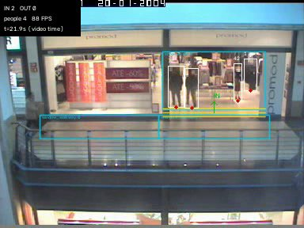
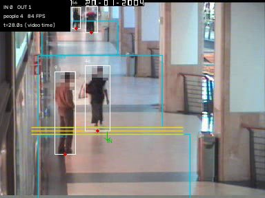
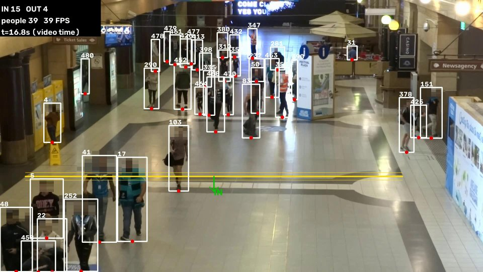

# 12 · Demo walkthrough

Three ways to see RetailFlow working, from fastest to fullest. Everything runs on public
research videos. All numbers below come from runs on the development laptop (RTX 4060 Laptop).

Before you start: the setup steps in the README, and at least CAVIAR downloaded
(`python tools/download_caviar.py`, 581 MB).

---

## A. One video → annotated output (2 minutes)

```powershell
python run.py --source data/caviar/TwoEnterShop1front/TwoEnterShop1front.mpg `
              --scene scenes/caviar_front.json --save-video --blur-heads --out outputs/demo/front
```

Look at `outputs/demo/front/`:
- `annotated.mp4`: boxes, track IDs, the **feet point** (red dot) used for counting, the counting
  line with its **band** (thin yellow lines) and IN arrow, zones with live occupancy, and
  **heads pixelated** (`--blur-heads`);
- `events.csv`: every crossing, zone visit (with dwell) and staff/static flag;
- `summary.json`: counts, customer counts (staff removed), timing;
- `heatmap.png`: where people spent time, over a people-free background.

| Demo clip | Predicted in / out | Ground truth in / out |
|---|---|---|
| `TwoEnterShop1front` (shop entrance) | 2 / 1 | 2 / 2 |
| `OneShopOneWait1cor` (corridor) | 0 / 2 | 1 / 3 |
| `MOT20-02`, first 30 s (crowd, 1920 px profile) | 22 / 4 | 18 / 0 |

These are single clips. The reliable numbers are the group results in `10_RESULTS.md`
(e.g. MOT20-02 is the known over-counting case, doc 10 §2.5).





**Heatmap on the playing video:** add `--heatmap-overlay` (with `--save-video` or `--show`).
The frame is tinted where people have spent time so far, building up as the video plays. Only
visited areas are coloured. For the live overlay everyone counts at once; the saved
`heatmap.png` and the dashboard still drop staff and mannequins.

**Your own video:** first draw the line and zones on one of its frames with
`python tools/setup_scene.py --source my_video.mp4 --camera my_cam` (writes `scenes/my_cam.json`),
then run `python run.py --source my_video.mp4 --scene scenes/my_cam.json`. `--duration 600` stops after 10 minutes.

## B. Live camera → dashboard (5 minutes)

```powershell
.\demo.ps1                     # needs Docker Desktop running
```

1. Starts PostgreSQL, the API (:8000), the dashboard (:3001) and the RTSP server (MediaMTX).
2. Publishes the shop-front video as a live RTSP camera (looped, real-time speed).
3. Runs the pipeline on the stream for 90 s, sending events to the API.
4. Opens <http://localhost:3001>. Choose `caviar_front`, then the session marked **live**:
   the KPIs, crossings chart and zone occupancy refresh every 5 s.

At the end the script prints the real-time check (`keeps_up: true`, `realtime_factor: 1.0`).
`docker compose --profile streaming down` stops the services.

What to point out on the dashboard:
- **Customers in / out** exclude staff and static objects (mannequins). "Excluded" shows how many
  crossings were removed and why.
- Time axes are **video time**: the data has no real business hours, so none are invented.
- The dwell table explains the 2 s visit rule. The heatmap appears when a session ends.

## C. Reproduce the evaluation (hours of GPU time)

```powershell
python tools/export_models.py                                         # TensorRT engines (doc 08)
python benchmark.py --configs baseline m960_botsort_nogmc_trt --datasets caviar mot17
python benchmark.py --configs baseline m1920_botsort_nogmc_trt --datasets mot17 mot20
python evaluate.py  --configs n640_bytetrack final --group camera     # counting before / after
python evaluate_zones.py                                              # zones, dwell, heatmaps
python tools/sync_caviar_views.py; python evaluate_multicam.py        # multi-camera
python run_multi.py --n 4 --seconds 60 --cams data/caviar/TwoEnterShop1front/TwoEnterShop1front.mpg
pytest -q                                                             # 88 tests
```

`docs/09_EVALUATION_METHOD.md` defines every metric; `docs/10_RESULTS.md` has all the tables.

## Demo videos

`outputs/demo/video_front.mp4`, `video_cor.mp4` and `video_mot20.mp4` (H.264, 1–15 MB, heads
pixelated) were made with mode A. They are not committed: `outputs/` is git-ignored, and the
videos are derived from the datasets, so they are regenerated rather than redistributed.
